# Grabbit

<p align="center">
  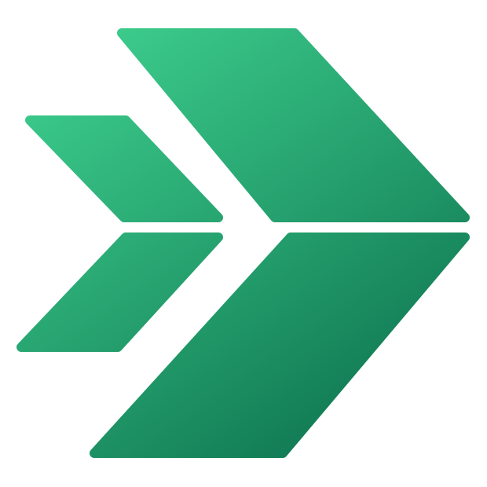
</p>

<h3 align="center">Downloads faster than IDM. Free, forever.</h3>

<p align="center">
  <a href="https://github.com/HUMBLEF0OL/grabbit/releases/latest"></a>
</p>

<p align="center">
  🧩 <b>Browser extension:</b><br>
  <a href="docs/guide-catch-browser-downloads.md#firefox"></a>
  <a href="docs/guide-catch-browser-downloads.md#chromium"></a><br>
  <sub>It comes with Grabbit (not in the stores yet): load it from Grabbit's folder in Chrome,
   Edge,
   Brave,
   Opera and Vivaldi, or Firefox (<a href="docs/guide-catch-browser-downloads.md">how</a>).</sub>
</p>

<p align="center">
  <a href="https://github.com/HUMBLEF0OL/grabbit/stargazers"></a><br>
  <sub>⭐ <b>Like it? Give it a star.</b> Grabbit has no ads and no marketing budget: stars are how people find it.</sub>
</p>

<p align="center">
  Windows 10 and 11<br>
  no ads, no trial, no sign-up
</p>

<table align="center">
  <tr>
    <td align="center" width="210"><h1>5×</h1><b>Faster</b><br><sub>a 1 GB file: 1 s instead of 5.5 s</sub></td>
    <td align="center" width="210"><h1>100%</h1><b>Cheaper (free!)</b><br><sub>no licence, no trial, ever</sub></td>
    <td align="center" width="210"><h1>Torrent</h1><b>Supported fully</b><br><sub>magnet links, .torrent files, seeding</sub></td>
  </tr>
</table>

<p align="center">
  <picture>
    <source media="(prefers-color-scheme: dark)" srcset="docs/images/main-dark.webp">
    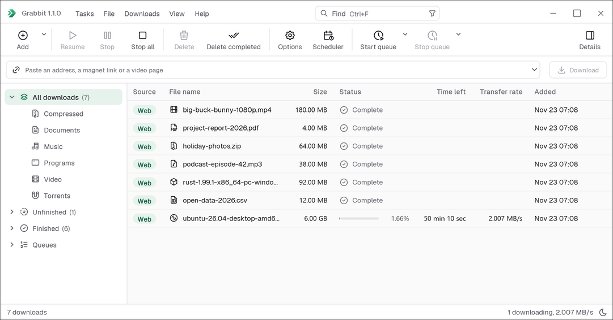
  </picture>
</p>

<p align="center">
  <a href="https://github.com/HUMBLEF0OL/grabbit/releases/latest"></a>
  <a href="https://github.com/HUMBLEF0OL/grabbit/releases"></a>
  <a href="https://github.com/HUMBLEF0OL/grabbit/actions/workflows/ci.yml"></a>
  <a href="https://github.com/HUMBLEF0OL/grabbit/stargazers"></a>
  <a href="LICENSE"></a>
</p>

| 🚀 [Download](#download) | ⚡ [Why switch](#why-switch-from-idm) | 🖼️ [Screenshots](#screenshots) | ✨ [Getting started](docs/getting-started.md) | 📜 [Help and tutorials](docs/README.md) |
| --- | --- | --- | --- | --- |

## Why switch from IDM?

**Same window you know. Your downloads finish sooner. And it costs nothing.**

<p align="center">
  <picture>
    <source media="(prefers-color-scheme: dark)" srcset="docs/images/races-dark.svg">
    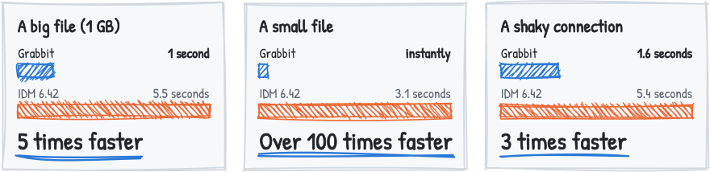
  </picture>
</p>

<!-- compare:start -->
| | Grabbit | IDM 6.42 |
| --- | --- | --- |
| Download a big file (1 GB) | **1 second** | 5.5 seconds |
| Download a small file | **instantly** | 3.1 seconds |
| Download over a shaky connection | **1.6 seconds** | 5.4 seconds |
| Wait before a download starts | **instantly** | 3.1 seconds |
| Price | **Free, forever** | Paid, after a 30-day trial |
| Ads, nag screens, sign-up | **None** | Registration needed |
| Open source | **Yes** (GPL) | No |
<!-- compare:end -->

Nothing new to learn: the toolbar, the categories, the list of downloads, the progress window and
the browser button are where you expect them. Measured on the same computer, same files, both
programs at their default settings ([how we measured](#the-benchmark-in-detail)).

## Download

<p align="center">
  <a href="https://github.com/HUMBLEF0OL/grabbit/releases/latest"></a>
</p>

On the [download page](https://github.com/HUMBLEF0OL/grabbit/releases/latest), pick
one:

| File | Choose it when |
| --- | --- |
| **`...-setup.exe`** | **Not sure? Take this one.** It installs Grabbit, connects it to your browser and asks your language. |
| `...-portable.zip` | You want Grabbit on a USB stick or without installing: unzip and run. Everything stays in its folder. |
| `...-x64.zip` | You want the plain programs without an installer. |
| `...-extension-chromium.zip` | You want to add the browser extension by hand (Chrome, Edge, Brave, Opera, Vivaldi). The setup puts the same files in Grabbit's `extension` folder ([how to add them](docs/guide-catch-browser-downloads.md)). |

> [!NOTE]
> Windows may say *"Windows protected your PC"* the first time, because this early version isn't
> code-signed yet. Click **More info**, then **Run anyway**.

## Screenshots

<table>
  <tr>
    <td width="50%">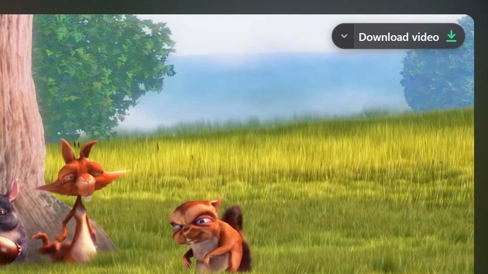<br><sub><b>One click on YouTube</b>: the Download video button appears over the video.</sub></td>
    <td width="50%">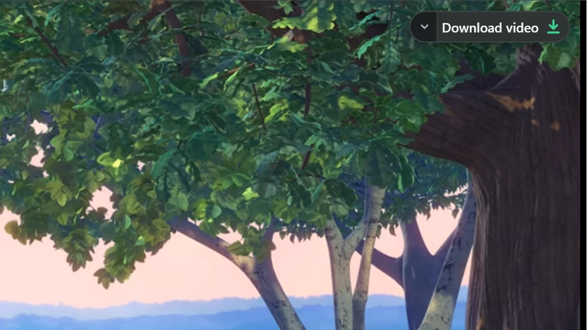<br><sub><b>Any video on any page</b>: drag the button where you like, it stays there.</sub></td>
  </tr>
  <tr>
    <td width="50%">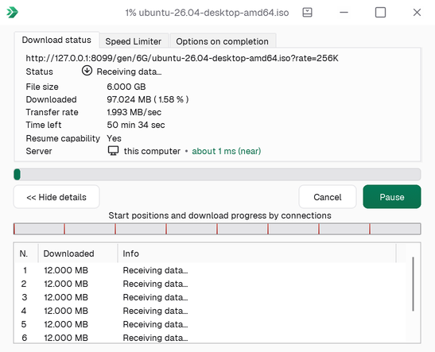<br><sub><b>Watch it fly</b>: every connection's share of the file, live speed and time left.</sub></td>
    <td width="50%">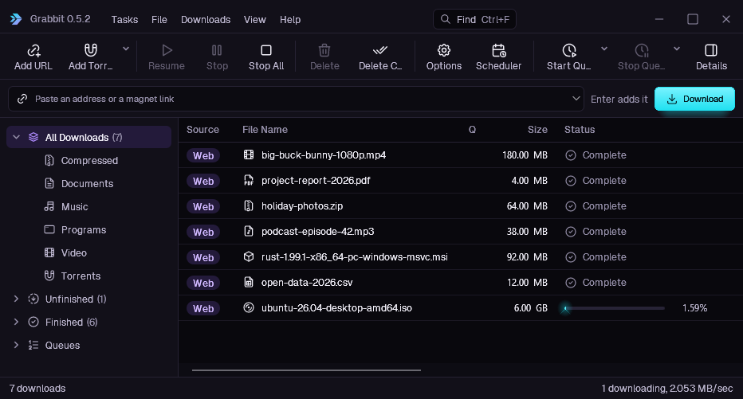<br><sub><b>Dark mode</b> that follows Windows.</sub></td>
  </tr>
  <tr>
    <td>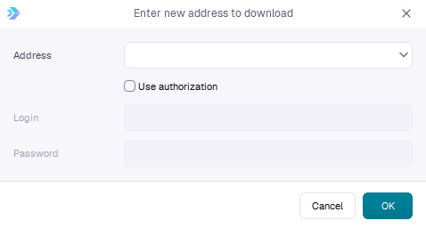<br><sub><b>Add a download</b>: paste a link, or let Grabbit catch it from your browser.</sub></td>
    <td>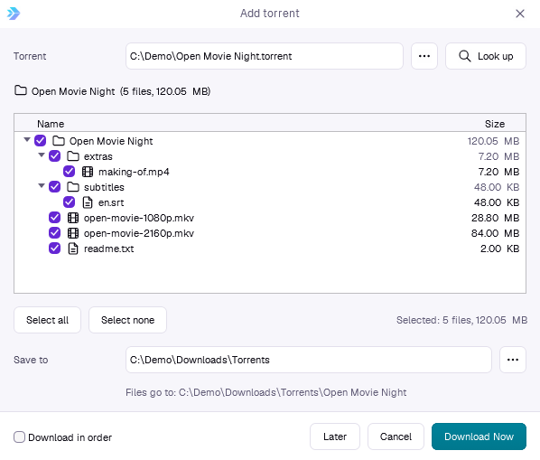<br><sub><b>Torrents and magnet links</b>: pick the files you want, skip the rest.</sub></td>
  </tr>
  <tr>
    <td>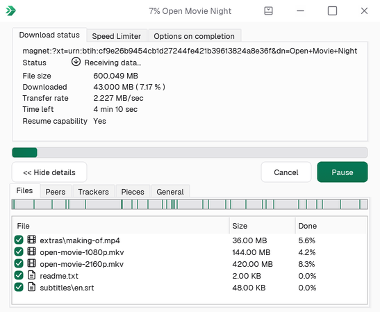<br><sub><b>A torrent's progress</b>: its pieces light up in the strip; Show details for its files, peers and trackers.</sub></td>
    <td>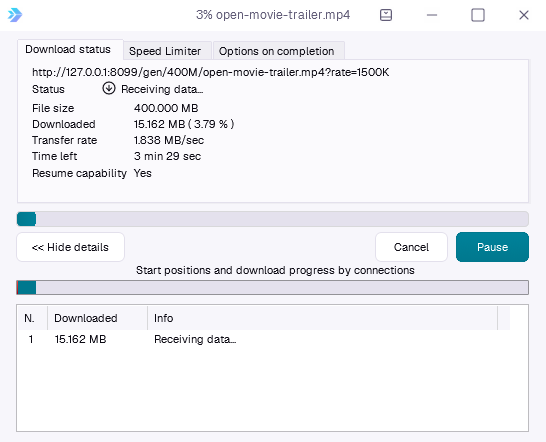<br><sub><b>A video's progress</b>: speed and time left while yt-dlp brings it in.</sub></td>
  </tr>
  <tr>
    <td>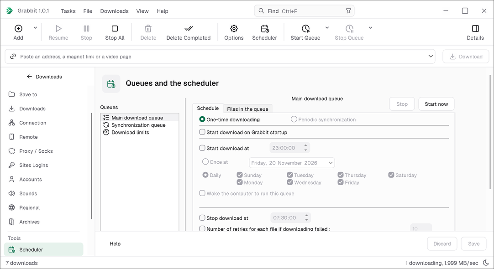<br><sub><b>Download overnight</b>: queues that start and stop on their own.</sub></td>
    <td>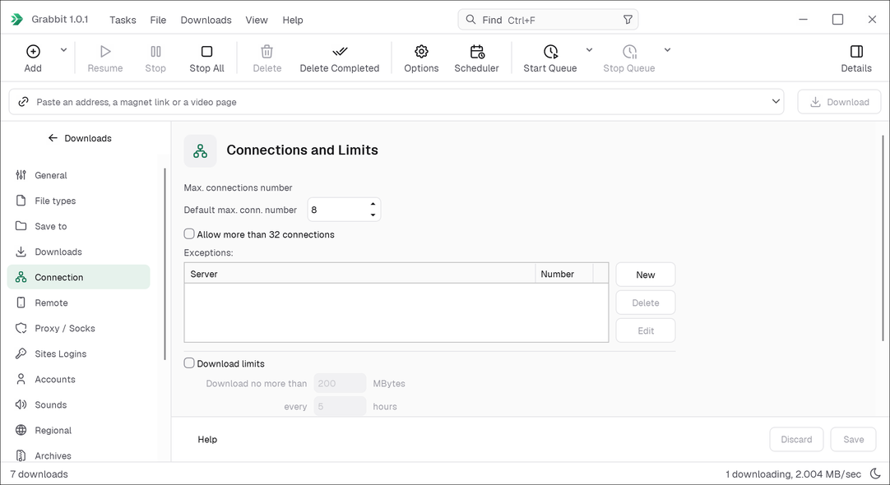<br><sub><b>Options</b> where you expect them, every control working.</sub></td>
  </tr>
</table>

## What it does

- **Speeds up every download** by fetching parts of the file at the same time, and keeps
  re-balancing until the last byte.
- **Resumes** after a crash, a restart or a dropped connection, without starting over.
- **Catches downloads from Firefox, Chrome, Edge, Brave, Opera and Vivaldi** (the extension is
  on Firefox Add-ons and the Chrome Web Store), and gives them back to the browser when Grabbit isn't
  running.
- **Downloads videos** from web pages (a button appears over the video; playlists, subtitles,
  the sound alone), **image galleries** with gallery-dl, and **torrents and magnet links**
  (sequential order, RSS feeds, sharing limits).
- **Many links at once**: the Link grabber sorts them into packages and extracts the archives
  (zip, 7z, rar) when they're in. Debrid accounts (Real-Debrid, AllDebrid, Premiumize; experimental) download
  file-host links through your own account.
- **Downloads overnight** with queues and a scheduler that can wake the computer, then shuts it
  down if you like.
- **Through your VPN only**, if you want: hold every download to one network adapter, with a kill
  switch, and choose an encrypted DNS. Each download shows its server's country.
- **From your phone, or on a server**: control Grabbit from a phone on your home network, or run it
  without a window on a PC that stays on ([how](docs/server.md)).
- **Works from scripts too**: IDM's command-line switches, a command-line tool, and a local API for other programs ([how](docs/command-line.md)).
- **Works with your AI assistant**: an MCP server lets Claude, Cursor or VS Code list, add, pause and remove your downloads ([set it up](docs/ai-assistants.md)).
- **Leaves you some speed**: limit one download or all of them, only while you're at the computer.
- **Day and dark mode, and themes**: Graphite, light and dark, or your own in a text file
  ([how](docs/themes.md)). Everything larger, up
  to 200 %, with **View → Interface size**. And a portable version for USB sticks.
- **Works from the keyboard and with screen readers** (Narrator, NVDA): every window, dialog and
  menu ([the keys](docs/keyboard-shortcuts.md)).
- **No ads, no trial, no account**. Free and open source.

Step by step: [your first download](docs/guide-first-download.md) ·
[catch every browser download](docs/guide-catch-browser-downloads.md) ·
[download overnight](docs/guide-download-overnight.md) ·
[download a video](docs/guide-video-from-page.md) · [all help pages](docs/README.md)

---

## The benchmark in detail

Both programs downloaded the same files from the same local test server
([labserver](crates/labserver)), with the network trouble each scenario names: seven runs each,
both at their default settings. Grabbit finished first in **all seven scenarios**; every difference is
statistically significant (Mann-Whitney p < 0.001), and Grabbit used less CPU in every one.

<p align="center">
  <picture>
    <source media="(prefers-color-scheme: dark)" srcset="docs/images/bench-time-dark.svg">
    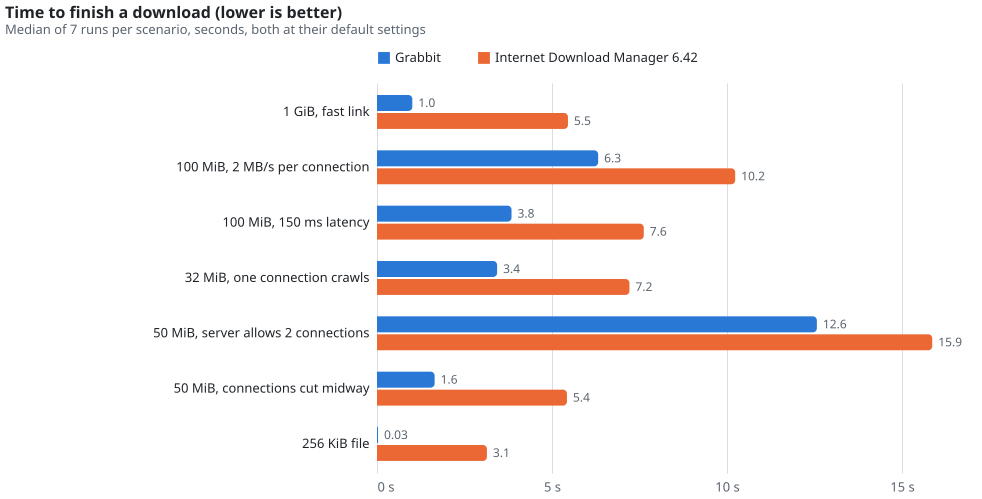
  </picture>
</p>

On a server that allows only two connections, Grabbit used 2 and still finished first; IDM opened 480.
The full table, the machine and the raw data: [docs/bench/run5/REPORT.md](docs/bench/run5/REPORT.md).
The harness is in [tools/bench](tools/bench), so anyone can run it again.

## Not a reverse-engineering project

Grabbit is an independent, clean-room program. It is a new implementation of a familiar way of
working, not a copy of anyone's software.

- **No one else's code or assets.** It contains no code, binaries, artwork, icons, sounds or
  text from Internet Download Manager, nor code from any other download manager. The app icon
  is Grabbit's own double chevron, drawn as plain vector shapes; the other icons come from openly
  licensed sets ([ATTRIBUTION.md](ATTRIBUTION.md)).
- **Nothing taken apart.** No IDM file was ever disassembled, decompiled, debugged, patched or
  inspected below its user interface, and its licensing, trial and registration were never
  touched or bypassed.
- **Learned as a user learns.** What Grabbit does was learned from IDM's public documentation and
  help pages, its public screenshots, and by using a licensed copy as a black box: downloading
  test files from our own test server ([labserver](crates/labserver)) and watching what reached
  the network and the screen.
- **Built on public standards.** The download engine follows the HTTP specifications (RFC 9110,
  RFC 9112) and was designed, tested and measured independently. Its speed comes from its own
  design, which the benchmark shows.
- **Not affiliated.** Grabbit isn't affiliated with, endorsed by or connected to Tonec Inc.
  "Internet Download Manager" and "IDM" are trademarks of their owner, named here only to
  describe the layout people already know and to compare the two programs.

## For developers

<details>
<summary><b>Build from source</b></summary>

Requires Rust stable 1.98 or later (the MSVC toolchain on Windows). Release builds
(`tools/installer/build.ps1`) also build the engine's browser-like connection on BoringSSL from
source, which needs CMake, NASM and LLVM's libclang (`winget install Kitware.CMake NASM.NASM
LLVM.LLVM`); everyday builds and tests leave it out (`--features grabbit-app/browser-connection`
adds it).

```
cargo build --release
cargo test
```

This makes `grabbit.exe` (the app), `grabbit-cli.exe` (headless
command line), `grabbit-mcp.exe` (the MCP server for AI assistants) and
`grabbit-nmhost.exe` (the browser host) in `target\release\`.
`tools\installer\build.ps1` builds the installer and both zips into `target\dist\` (needs
[Inno Setup 6](https://jrsoftware.org/isinfo.php)); a release is built, signed and published
from the maintainer's computer with `tools\installer\publish.ps1` (see
[CONTRIBUTING.md](CONTRIBUTING.md#branches)).

Browser integration from a build: register the native messaging host with
`target\release\grabbit-nmhost.exe --register` (undo with `--unregister`), then in
`chrome://extensions` or `edge://extensions` turn on Developer mode, **Load unpacked** and pick
the `extension/` folder (its ID is always `oogbclbbninliongijffeeggalppliok`).

</details>

<details>
<summary><b>Layout and tools</b></summary>

A Cargo workspace (edition 2024); [docs/ARCHITECTURE.md](docs/ARCHITECTURE.md) explains how the
pieces fit.

| Crate | What it is |
|---|---|
| [`grabbit-engine`](crates/engine) | The download engine: segmentation, connections, resume, limits |
| [`grabbit-app`](crates/app) | The desktop app (egui), and `--headless` for servers |
| [`grabbit-cli`](crates/cli) | Headless downloads from the command line |
| [`grabbit-mcp`](crates/mcp) | The MCP server, for AI assistants |
| [`grabbit-nmhost`](crates/nmhost) | The browser's native messaging host |
| [`grabbit-ipc`](crates/ipc) | Talking to a running app; shared capture rules; the extension's IDs |
| [`grabbit-remote`](crates/remote) | The remote control: the HTTPS server and page a paired phone uses |
| [`grabbit-crash`](crates/crash) | Crash and freeze reports: the monitor, minidumps, stacks |
| [`grabbit-debrid`](crates/debrid) | Debrid accounts through the services' official APIs |
| [`grabbit-extract`](crates/extract) | Archive extraction (zip, tar, gz, xz; 7z and RAR through 7-Zip) |
| [`grabbit-geo`](crates/geo) | A server's country, from an IP table on this computer |
| [`grabbit-tools`](crates/tools) | yt-dlp and ffmpeg for video pages, gallery-dl for galleries |
| [`grabbit-torrent`](crates/torrent) | BitTorrent through librqbit |
| [`grabbit-labserver`](crates/labserver) | An HTTP test server with fault injection, for tests and benchmarks |

| Tool | What it does |
|---|---|
| `node tools/extension/e2e.mjs` | The browser extension in real Chrome, Brave, Edge and Firefox, headless: a link's download must reach Grabbit (or another Grabbit, a server) |
| `node tools/readme/build.mjs` | This page's pictures and comparison table, from the benchmark data |
| `tools\lab\docs-shots.ps1` | The screenshots, from a separate test instance (`/show <window>` opens each window), off the screen |
| `python tools/shots/make.py` | The help pages' pictures, from one list (`tools/shots/shots.toml`): shot, cropped, annotated, lossless WebP; `make.py check` keeps them in step |
| `tools\lab\progress-shots.ps1` | The progress window of a video (yt-dlp) and of a torrent, from a swarm on this computer (`cargo run -p grabbit-torrent --example swarm`) |
| `python tools/website/build.py --serve` | humblef0ol.github.io/grabbit into `target/site` (help pages from `docs/`, news from the CHANGELOG, FAQ and legal pages from `website/content/`), served on http://127.0.0.1:8765/grabbit/; GitHub Pages publishes it (`pages.yml`) |
| `python tools/readme/social.py` | The repository's social preview card (`docs/images/social-preview.png`) |
| `MDM_FIT_AUDIT=<file>` | Lists every text that doesn't fit its window or runs over another |
| `MDM_OFFSCREEN=1` | Opens every window off the screen, without focus, tray icon or sound (screenshots and checks) |
| `MDM_TEST_TRASH_DIR=<folder>` | Tests only: archives deleted after extracting, and deleted downloads' finished files, go into this folder, never into the real Recycle Bin |
| `MDM_TEST_7ZIP=<program>\|none` | Tests only: the 7-Zip program to use for 7z and RAR archives, or `none` to act as if 7-Zip weren't installed |

</details>

## Status and helping out

Grabbit is young: the engine, the main window and the browser integration are solid on Windows, and
some corners are still "good enough for now".

- **English only.** The interface, the installer, the extension and the website are in English;
  the earlier translations are kept on the `archive/multiplatform-i18n` branch.
- **Windows only.** Linux and macOS builds are no longer made; the code that ran there is kept on
  the `archive/multiplatform-i18n` branch.
- Not yet: code signing.

Bug reports and ideas are welcome in
[Issues](https://github.com/HUMBLEF0OL/grabbit/issues/new/choose): **Help → Report a problem**
in the app fills in your version and system. Pull requests are accepted under the same licence: start with [CONTRIBUTING.md](CONTRIBUTING.md).

## Made possible by these amazing humans

Everyone who sent a pull request, opened an issue or joined a conversation here: thank you. People
with pull requests first, then issues, then comments; [the website](https://humblef0ol.github.io/grabbit/contributors.html)
shows what each one did.

<!-- contributors:start (python tools/contributors.py readme) -->
<p>
<a href="https://github.com/AzureKnigh7" title="AzureKnigh7"></a>
<a href="https://github.com/specailm5" title="specailm5"></a>
<a href="https://github.com/osunday" title="osunday"></a>
<a href="https://github.com/SwiftyPop" title="SwiftyPop"></a>
<a href="https://github.com/mfat" title="mfat"></a>
<a href="https://github.com/praveenkumar2K06" title="praveenkumar2K06"></a>
<a href="https://github.com/shreeramncity" title="shreeramncity"></a>
<a href="https://github.com/AwesomeIronman" title="AwesomeIronman"></a>
<a href="https://github.com/Maldo-0750" title="Maldo-0750"></a>
<a href="https://github.com/Twig6943" title="Twig6943"></a>
<a href="https://github.com/ADIxxDEV" title="ADIxxDEV"></a>
<a href="https://github.com/crse" title="crse"></a>
<a href="https://github.com/dhrubo11" title="dhrubo11"></a>
<a href="https://github.com/Drigva" title="Drigva"></a>
<a href="https://github.com/EnderDobra" title="EnderDobra"></a>
<a href="https://github.com/farjanatech" title="farjanatech"></a>
<a href="https://github.com/gowzee" title="gowzee"></a>
<a href="https://github.com/husnainahmedrana" title="husnainahmedrana"></a>
<a href="https://github.com/justnxhom" title="justnxhom"></a>
<a href="https://github.com/mayankmohan1992" title="mayankmohan1992"></a>
<a href="https://github.com/Mpsp4321" title="Mpsp4321"></a>
<a href="https://github.com/sadatdaniel" title="sadatdaniel"></a>
<a href="https://github.com/SHURmanizer" title="SHURmanizer"></a>
<a href="https://github.com/Uyaii" title="Uyaii"></a>
<a href="https://github.com/Volcanify" title="Volcanify"></a>
<a href="https://github.com/Zekidt" title="Zekidt"></a>
<a href="https://github.com/Stark-0505" title="Stark-0505"></a>
<a href="https://github.com/dr-strange15" title="dr-strange15"></a>
</p>
<!-- contributors:end -->

## ⭐ Star history

If Grabbit saves you time, a star is the quickest way to say so, and it helps the next person find
a free download manager. [Star it on GitHub](https://github.com/HUMBLEF0OL/grabbit/stargazers).

<a href="https://star-history.com/#HUMBLEF0OL/grabbit&Date">
  <picture>
    <source media="(prefers-color-scheme: dark)" srcset="https://api.star-history.com/svg?repos=HUMBLEF0OL/grabbit&type=Date&theme=dark">
    
  </picture>
</a>

## Support Grabbit

Grabbit is free and always will be. If it saves you time, [star it on
GitHub](https://github.com/HUMBLEF0OL/grabbit/stargazers). Nothing in the app changes or unlocks,
and there is no paid edition.

## Licence and credits

Copyright (c) 2026 HUMBLEF0OL and contributors; portions copyright (c) 2026 Ahmed Nefzaoui
(Mister Download Manager). Grabbit is free software under the
[GNU General Public License, version 3](LICENSE) or (at your option) any later version.

Grabbit began as a fork of Mister Download Manager by Ahmed Nefzaoui
(`anefzaoui/misterdownloadmanager`), and still takes in its fixes.

Built on [egui](https://github.com/emilk/egui) through
[storytold's forks](https://github.com/storytold/egui) and
[storytold/craft-libs](https://github.com/storytold/craft-libs) (MIT OR Apache-2.0),
[librqbit](https://github.com/ikatson/rqbit) (Apache-2.0),
[zip](https://github.com/zip-rs/zip2) (MIT), and [yt-dlp](https://github.com/yt-dlp/yt-dlp)
(Unlicense, run as a separate program; as are 7-Zip for 7z and RAR archives). Flags from
[flag-icons](https://github.com/lipis/flag-icons) (MIT); pictures drawn with
[rough.js](https://roughjs.com/) (MIT) in [Patrick Hand](https://fonts.google.com/specimen/Patrick+Hand)
(SIL OFL) and [Vega-Lite](https://vega.github.io/vega-lite/) (BSD-3). Bundled icons and artwork
keep their own licences, listed in [ATTRIBUTION.md](ATTRIBUTION.md).
