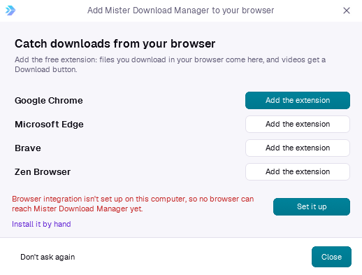
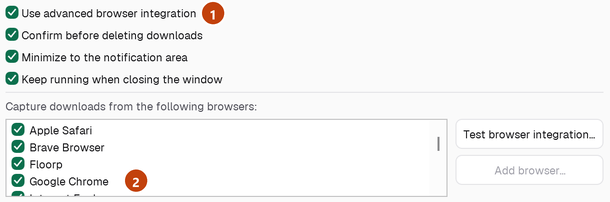
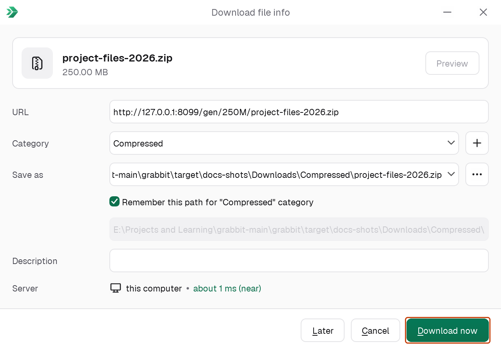
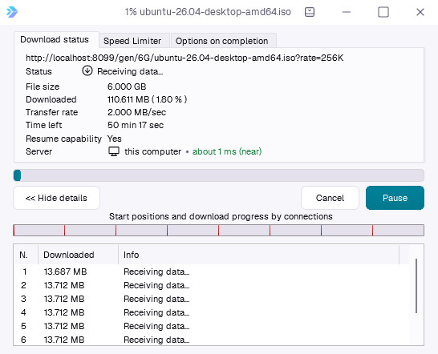
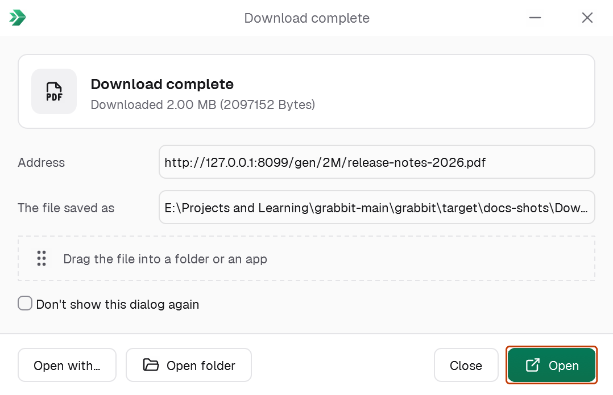
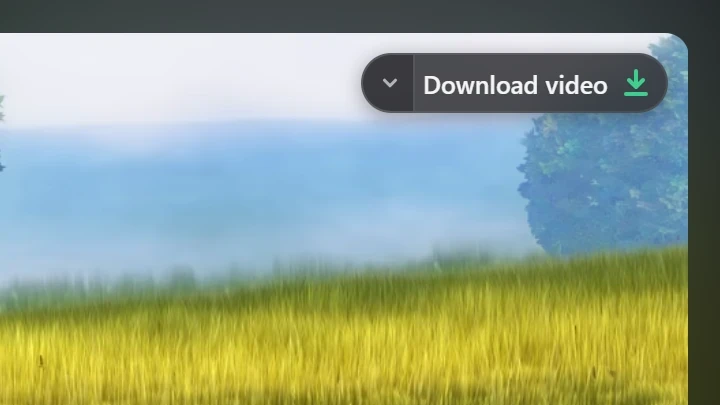
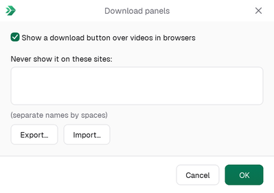
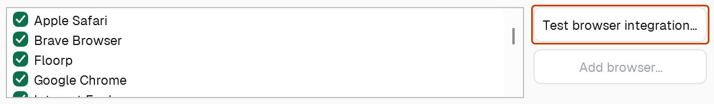

# Browser integration

[← Back to docs index](README.md)

With the Grabbit extension, clicking a download link in your browser hands the download to Grabbit. Grabbit gets the address together with the page it came from (the referrer), your cookies for the site and the browser's User-Agent, so downloads that need you to be signed in still work. It also gets the address the browser's own download had reached: when a site refuses Grabbit the link itself (a one-time link the browser has already used, or a site that lets only browsers ask for its links), Grabbit goes on from there once, without your cookies if it is another site. When a site's bot check (Cloudflare's, for one) or its refusal of programs (FileHippo's *412 Precondition Failed*) turns Grabbit's own connection away, Grabbit asks once more connecting the way your browser does (the same handshake, settings and order of headers), with your browser's User-Agent and its cookies for that site only, and downloads on it with as many connections as any download, each asking for its part of the file (on one connection when the site refuses parts there); your proxy, network adapter and speed limits apply as usual. The pieces of a video stream (HLS, DASH) go the same way when the site's check refuses them. Some checks (SourceForge's) refuse anything that calls itself a browser without connecting exactly like one, and let a program that says what it is through: when that connection is refused too, Grabbit asks once more under its own name (`Grabbit/` and its version, or the User-Agent you typed in **Options → Downloads**), with the same cookies and referrer, and remembers the site until Grabbit closes, so its next downloads, and a paused one when it resumes, go that way at once. It solves no challenge: a site that still wants one answered (some Cloudflare checks ask it of every visitor, for the site's pages too) refuses again, and Grabbit says *this site lets only browsers through*; Alt+click the link to leave the download to the browser, which opens the link, passes the check and keeps the file.

The extension works in **Google Chrome**, **Microsoft Edge**, **Brave**, **Opera** and **Vivaldi**, and in **Firefox** 140 or later.

Browsers built on them work too: Chromium and Helium take the extension as Chrome does, Brave Origin as Brave does, Zen and LibreWolf as Firefox does. Zen has a bug of its own (see [The browser and Grabbit aren't connected](browser-help.md#not-installed)).

## Set it up

Browser integration has two parts: a small helper program that the browser talks to, and the extension itself.

1. Install Grabbit with the setup and keep **Set up browser integration (Chrome, Edge, Brave, Firefox)** ticked. This registers the helper. (The portable copy can't do this; see [Portable mode](portable.md).)
2. Add the extension to each browser you use, as below. It isn't in the browsers' stores yet: it comes with Grabbit, in the `extension` folder where Grabbit is installed (`%LOCALAPPDATA%\Programs\Grabbit\extension` if you installed it for yourself, or `Program Files\Grabbit\extension` if you installed it for everyone). Every release also has it as its own download, `...-extension-chromium.zip` (unzip it first) and `...-extension-firefox.xpi`. An extension named **Mister Download Manager** in the stores belongs to another project and doesn't connect to Grabbit. Until a browser's extension has reached Grabbit, Grabbit's **Add Grabbit to your browser** window opens at each start: it lists the browsers it found, and **Show me how** opens the steps for that browser; **Don't ask again** stops the window. The same list is in Options, under **Tools → Browser extension**, whenever you want it.


*Grabbit's own window lists each browser it found.*

### Chrome, Edge, Brave, Opera and Vivaldi

1. Open the extensions page: `chrome://extensions`, `edge://extensions` or `brave://extensions`.
2. Turn on **Developer mode**.
3. Click **Load unpacked** and choose the `extension\chromium` folder.

**Grabbit** appears in the list. Leave it turned on. Pin its button to the toolbar to see at a glance whether the browser reaches Grabbit. [The tutorial](guide-catch-browser-downloads.md#chromium) shows each step.

### Firefox

Firefox 140 or later is needed. Firefox installs for good only add-ons Mozilla has signed, and Grabbit's isn't signed yet: load `extension\mdm-firefox.xpi` as a temporary add-on (`about:debugging` → **This Firefox** → **Load Temporary Add-on...**), which lasts until Firefox closes, or install it for good in Firefox Developer Edition or Nightly with `xpinstall.signatures.required` set to `false`. [The tutorial](guide-catch-browser-downloads.md#firefox) shows both.

### From the plain zip

The `-x64.zip` copy has no installer, but you can register the helper yourself. Open a command prompt in Grabbit's folder and run:

```
grabbit-nmhost.exe --register
```

This is for your Windows account only. `--unregister` undoes it. Then load the extension as above, from the zip's `extension` folder.

Extract the zip to a folder of its own first. Run from inside the zip, or from anywhere in the temporary folder, the helper registers nothing: that folder is deleted afterwards, and the browsers would be left looking for a helper that is gone.

## What it takes

When you click a download, the extension checks Grabbit's Options:

- **Options → General → Use advanced browser integration** must be on. Turn it off to send nothing to Grabbit.
- **Options → General → Capture downloads from the following browsers** must have your browser ticked.
- **Options → File types → Automatically start downloading the following file types** must list the file's type. The list starts with the usual ones: ZIP, RAR, 7Z, EXE, MSI, ISO, DMG, DEB, RPM, APPIMAGE, MP3, MP4, MKV, WEBM, PDF, AI models such as GGUF and SAFETENSORS, 3D files such as GLB and STL, and many more. Anything else can be added to the list.
- **Options → File types → Don't start downloading automatically from the following sites** must not list the site. Names are separated by spaces, and `*` matches any part, as in `*.update.microsoft.com`. **Edit list ...** below it lists whole addresses to leave alone, one per line (`https://example.com/private/*`).
- **Options → File types → Don't take files smaller than** leaves small files (a receipt, an icon) to the browser. 0 takes any size.
- A `.torrent` file goes to Grabbit only while **Downloads → Options → Torrents → Open magnet links and .torrent files with Grabbit** is on. Off, the browser keeps it and opens it in your own torrent program. See [Torrents](torrents.md#add-a-torrent).
- The extension must be allowed to read the site. When you limit it to some sites (or **On click**), it can't pass your sign-in on, so it leaves those sites' downloads to the browser.


*1 must be on, and 2 your browser ticked.*

When the browser keeps a download, the extension's button says which of these left it there, with the file's name, and Grabbit's log has a line for each one (`logs\mdm.log` in [Grabbit's data folder](crash-reports.md#where-reports-are-kept)).

Both the address you clicked and the one its redirects led to are checked, so a site you excluded stays excluded even when it sends you to another server. Everything else stays with the browser. Changes in Options reach the browser within a minute; you don't need to restart it.

When Grabbit takes a download, it gets the browser's file name, size and type with it, so **Download File Info** shows them at once without asking the server again. A download from a form (a button that posts and gets a file back) is posted again by Grabbit with the form's data; a form that sends a file stays with the browser.

When Grabbit takes a download, the browser's own copy is cancelled and removed from the browser's download list. In Firefox and the browsers built on it (Waterfox, Zen, LibreWolf), Grabbit takes it as soon as the server answers, before the browser asks *What should … do with this file?*: for a file Grabbit takes, that question never shows (Waterfox asks it for every new type of file). Files Grabbit doesn't take get the question as before. **Download File Info** opens in Grabbit (unless you turned it off in **Options → Downloads**). Cancelling there doesn't hand the download back to the browser.

<!-- steps -->

1. 
   *Click a download link in the browser: Download File Info opens in Grabbit.*
2. 
   *Start Download: the progress window shows it coming in.*
3. 
   *Download complete: Open the file, or Open folder.*

Downloads from a private window use that window's cookies, never the normal ones, and aren't kept in Grabbit's list after it closes.

Files Grabbit downloads from the browser are marked as coming from the internet, as the browser marks its own: Windows checks a program with SmartScreen before it runs and Office opens a document in Protected View. Like the browser, Grabbit leaves the mark out when Windows' Group Policy **Do not preserve zone information in file attachments** is on; [Options → Save to](options.md#save-to) can turn it off for Grabbit alone.

## Files the browser would open

A PDF, a song or a video that the browser would show or play itself goes to Grabbit too, when its type is in **Options → File types** (not on the excluded sites). To turn this off, untick **Also take files the browser would open** in **Options → General → Keys...**. This needs a Chromium browser (Chrome, Edge, Brave, Opera, Vivaldi) version 128 or later, or Firefox.

## The toolbar button

The extension's button shows whether the browser reaches Grabbit. A red **!** means it doesn't; click the button to see why, and **How to fix it** opens the matching section of [The browser and Grabbit aren't connected](browser-help.md). The button also:

- **Take downloads from this browser**: untick it to pause, and every download stays with the browser until you tick it again.
- **Never take downloads from** the current site: adds it to Grabbit's excluded sites.
- **Open Grabbit** and **Options...**.
- **Media on this page**: what the page has loaded that Grabbit can download (see below).

## A VPN or proxy extension

A VPN or proxy extension is a proxy for the browser only. Switch on **Send downloads through this
browser's proxy or VPN extension** in the extension's toolbar popup (it's off as installed), and
Grabbit downloads what it takes from the browser through the same proxy (with **Options → Proxy /
Socks → Use proxy/socks from a browser's request**, on by default; see
[Options](options.md#proxy--socks)). Switched off, the extension reads nothing of the browser's
proxy.

- **Firefox** asks you once, at the switch, to allow the extension to read the browser's proxy;
  switching it off takes that permission back. Grabbit gets the proxy the browser's own request for
  the file took, including the ones a VPN extension picks for each request.
- **Chrome, Edge, Brave, Opera and Vivaldi** can't ask for that permission at the switch, so the
  extension has it from the install (Chrome counts it under the access to every site the extension
  already asks for, so it adds no line to the install prompt and the update asks for nothing new).
  The switch asks nothing. Grabbit gets the browser's effective proxy, whoever set it (a VPN or proxy
  extension, a policy, the command line): a fixed server for the download's scheme (`http`,
  `https`, `socks4`, `socks5`), unless the address is on its bypass list, or its proxy auto-config
  script (by its address or inline). With no proxy, or the system's, nothing is sent and Grabbit goes
  by its own Options. A QUIC proxy can't be shared.

In both, the proxy's login is never read: a proxy that asks for the VPN extension's own login
can't be shared, and the download says so rather than going without it.

## Media on this page

Some pages play a video without a link to it, and some players hide it from the download button
too. The toolbar button lists what the page has loaded, so you can still save it:

- **Streams**: HLS (`.m3u8`) and DASH (`.mpd`), the way most sites play long videos. Each stream
  is listed once, however many qualities its player switched between, with its qualities (`1080p ·
  720p`) and its length when the extension can read them. A stream whose address doesn't end in
  `.m3u8` or `.mpd`, served as plain text, is found too: when you open the list (or press the
  download button over its player) and the player plays a stream, the extension reads the first
  few kilobytes of what that player fetched to recognise it. Nothing is read until you ask.
- **Video and sound files** the page played (MP4, WebM, MP3 and the like), with their size and,
  for a video, its picture size.

Start the video first: the list fills as the page loads things, and it's emptied when the tab goes
to another page. Each file is listed under the name it will be saved with. A file the site sends
through a program's address (`stream.php`, `remote_control.php`, `videoplayback`, a bare number)
has no name of its own: it's named after the page (`The page.mp4`), or after the `file=` name in
its address when there is one, with the type its server says it is (MP4, not PHP). With **Prefix
media file names with the page title** on, a file with a name of its own is named after the page,
then that name (`The page - clip.mp4`). Click **Download** beside one: a stream opens Grabbit's **Download video from a page**
window, which reads its qualities (yt-dlp does the work); a file goes to Grabbit's list like any other
download. Your cookies for its server, the page as the referrer and your browser's User-Agent go
with it, as they do for a link you click.

Pieces of a stream (its segments) are never listed. A copy-protected stream (DRM: Widevine,
PlayReady, FairPlay, as most paid streaming services use) is listed as **Protected**, with no
**Download** button: no tool may break that protection, and Grabbit doesn't try.

This needs nothing more from you: the extension already sees what the browser downloads in order
to hand downloads over. What it notes stays in the browser's memory and is forgotten when the
browser closes.

## Right-click: Download with Grabbit

Right-click a link, a video, a sound or a picture and choose **Download with Grabbit**. Grabbit downloads it whatever its type: you asked for it, so the file types list and the excluded sites don't apply here (they only decide which downloads Grabbit takes over by itself). A video that plays as a stream goes to the **Download video** window with the stream its player loaded (HLS or DASH), as the [button over videos](#the-download-button-over-videos) sends it, with your cookies for the stream's server and what the browser sent with the stream (its referrer and origin, else the page as the referrer).

Select part of a page and right-click it for **Download selected links with Grabbit**, or right-click the page for **Download all links with Grabbit**: the links open in **[Link grabber](link-grabber.md)**, sorted into packages, where you tick the ones you want.

If Grabbit can't be reached when you choose one of these, the help page opens at the section that explains why.

## The download button over videos


*The button over a video. Drag it where you like; it stays there.*

Point at a video on a web page and a small round button with a green arrow appears in its corner; point at the button and it opens to **Download video**. Click it and Grabbit's **Download video from a page** window opens and looks up the qualities it can download. It takes the video you clicked: its own file when it plays one, or the stream the player loaded (HLS or DASH), else the page. When the button can't tell which one you mean, the toolbar button's [Media on this page](#media-on-this-page) lists them all. Embedded players work too, and your sign-in for the site, the page that embeds the player and your browser's User-Agent go with it, so videos for members, or that play only on the site that embeds them, can be downloaded. A stream goes with what the browser sent when the player asked for it, its referrer, its origin and its cookies (a player embedded from another site may have cookies the browser keeps for that page only), and they are sent again with its playlists and pieces: a site's video server that serves its own pages' players only lets Grabbit through as well. Sound players get the button too.

It stays out of the way: it shows only while you point at a video (or the player has the keyboard's focus; **Tab** then moves to the button), fades when the pointer rests, and leaves out small videos and short muted loops (animated pictures, backgrounds). In fullscreen it follows the video when the player allows it. After a click it says for a moment what happened (**Sent to Grabbit**, or why not). On a copy-protected video (DRM) it says that the video can't be saved.

- **Move it**: drag it anywhere along the video's edge; it snaps to the nearest edge and stays there on that site.
- **Its menu** (the small ⌄ at its end, shown while you point at it): **Hide on this video**, **Never on** the site (Grabbit remembers the site), and **Button settings...**, which opens Grabbit's Options.
- **Turn it off, or see the sites it stays off**: **Options → General → Customize Grabbit Download panels in browsers → Edit...**.


*Options → General → Edit...: turn the button off, or list sites it never shows on.*

The button follows the rest of the integration: it doesn't show when **Use advanced browser integration** is off or the browser is unticked.

## Keys to force or prevent capture

Hold **Alt** while clicking a link to let the browser download it instead of Grabbit. The extension follows the link as a plain click would, in every browser, and the browser keeps what comes of it: the link opens in the tab, so a site's bot check (Cloudflare's "Just a moment...") runs there first. Without the extension in the way, Chromium browsers would save the link without opening it, which saves the check's page instead of the file; Firefox would do nothing. When the link redirects, or the page it leads to starts the download by script ("your download starts in 5 seconds"), that download stays with the browser too when it starts within ten seconds; the link's own address, and a download its own page starts (a bot check's page once its check is passed), within a minute. **Alt** with **Ctrl** or **Shift**, and the middle button, keep their meaning (a new tab or window). **Options → General → Keys...** says so, and holds **Also take files the browser would open**.

To keep a site's downloads in the browser for good, use the toolbar button's **Never take downloads from**, or add the site to **Don't start downloading automatically from the following sites**. To keep a file type in the browser, take it off the file types list.

## When Grabbit isn't running

You don't need to start Grabbit first. When the browser hands over a download and Grabbit isn't running, the helper starts it and passes the download on.

If Grabbit can't be reached at all (it was uninstalled, or the helper isn't registered), the download stays with the browser, so nothing is lost, and the toolbar button shows a red **!**. See [The browser and Grabbit aren't connected](browser-help.md), or run **Options → General → Test browser integration...**.


*Test browser integration... says whether the browser reaches Grabbit.*

## Next steps

- [Tutorial: catch downloads from your browser →](guide-catch-browser-downloads.md)
- [Change which file types Grabbit takes →](options.md)
- [If the browser doesn't hand downloads over →](troubleshooting.md)
