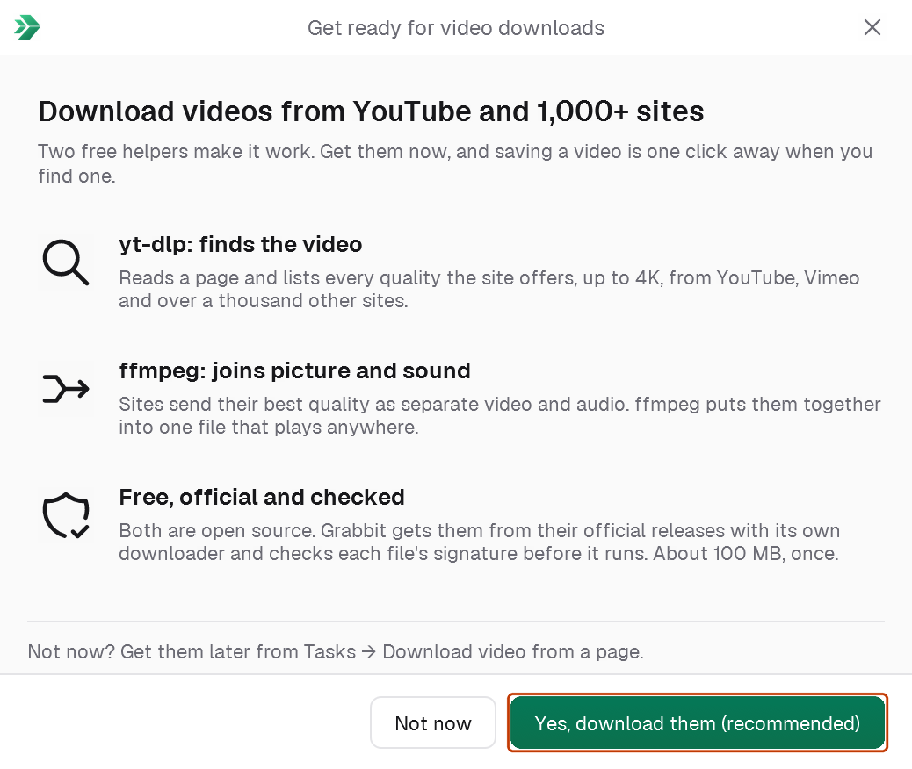
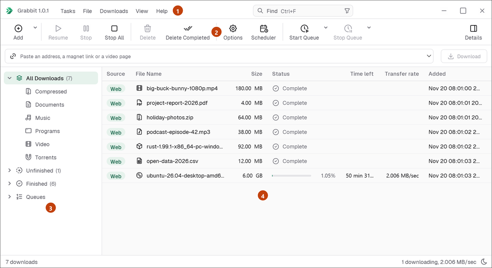
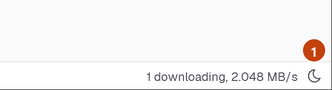
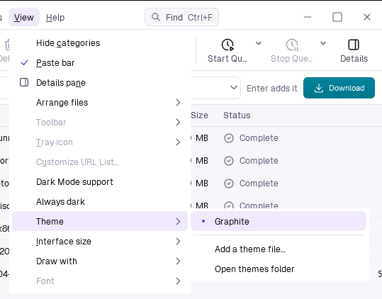

# Getting started

[← Back to docs index](README.md)

Grabbit runs on 64-bit Windows 10 and Windows 11.

## Choose a download

Every version is on the [Releases](https://github.com/HUMBLEF0OL/grabbit/releases) page. There are three files:

| File | What it is |
|---|---|
| `Grabbit-<version>-setup.exe` | The installer. Pick this one unless you have a reason not to. It can set up browser integration and open `.torrent` files and magnet links with Grabbit. |
| `Grabbit-<version>-portable.zip` | A portable copy. The download list and settings stay in a `data` folder next to the program, and nothing is written to the registry. Browser integration needs the installer. See [Portable mode](portable.md). |
| `Grabbit-<version>-x64.zip` | The same programs without an installer. It keeps its data in `%APPDATA%\grabbit`, like an installed copy. |

## Install with the setup

1. Run `Grabbit-<version>-setup.exe`.
2. Choose whether to install for you only or for everyone on the computer. For you only needs no administrator rights and goes to `%LOCALAPPDATA%\Programs\Grabbit`. For everyone goes to `Program Files`.
3. Pick what the setup should do:
   - **Set up browser integration (Chrome, Edge, Brave, Firefox)**
   - **Open .torrent files and magnet links with Grabbit**
   - **Start Grabbit when Windows starts**
   - **Create a desktop shortcut** (off unless you tick it)
4. Click **Install**, then **Finish** to start Grabbit.

If Grabbit is already running, the setup asks it to save and close first. To update, use **Help → Check for updates → Update now**, or run the setup of the new version; your list and settings stay.

Browser integration needs one more step in each browser: adding the extension. It comes with Grabbit, in the `extension` folder where Grabbit is installed: in Chrome, Edge, Brave, Opera and Vivaldi, **Load unpacked** the `extension\chromium` folder; in Firefox, load `extension\mdm-firefox.xpi`. [The tutorial](guide-catch-browser-downloads.md) shows how.

### Uninstall

Uninstall Grabbit from Windows **Settings → Apps**. The uninstaller asks whether to delete your download list and settings too. Your downloaded files are never touched.

## Use a zip copy

1. Unzip the file to a folder you can write to (not straight into `Program Files`).
2. Run `grabbit.exe`.

The zips hold the same programs as the setup: the app, `grabbit-cli.exe` (downloads from the command line; see [Command line and automation](command-line.md)) and the `extension` folder.

## The video helpers

Next, Grabbit offers its two free video helpers: **yt-dlp**, which finds the video on a page, and
**ffmpeg**, which joins its picture and sound. Click **Yes, download them (recommended)** and they
download in the background, about 100 MB, once. **Not now** leaves them for later: the video
window offers them when you first need them. More in [Videos](video.md).

*Yes downloads both helpers in the background, once.*

## The main window

*1 the menu bar, 2 the toolbar, 3 the categories, 4 the download list.*

From top to bottom:

- **Menu bar.**
  - **Tasks** — add downloads, torrents, magnet links, batch downloads and videos from a page; **Torrent settings**; **Link grabber**; **RSS feeds**; show the drop target; import and export the list; exit.
  - **File** — the selected download: **Stop Download**, **Remove**, **Download Now**, **Redownload**.
  - **Downloads** — **Pause All**, **Stop All**, **Delete All Completed**, **Find**, the **Scheduler**, queues, the **Speed Limiter** and **Options**.
  - **View** — show or hide the categories, sort the list (**Arrange files**), **Theme**, **Interface size** (every window larger, 100 % to 200 %; **Ctrl +**, **Ctrl −** and **Ctrl 0** too), **Draw with** (OpenGL or Direct3D) and **Language**.
  - **Help** — help pages and tutorials (on the website), **Keyboard shortcuts**, **Report a problem**, **Check for updates**, **About**, **Tell a friend** and **Support Grabbit** (Grabbit's page on GitHub, to star it: optional, nothing in Grabbit changes).
- **Toolbar.** **Add URL**, **Add Torrent**, **Resume**, **Stop**, **Stop All**, **Delete**, **Delete Completed**, **Options**, **Scheduler**, **Start Queue**, **Stop Queue**. The small arrow next to **Add Torrent**, **Start Queue** and **Stop Queue** opens more choices.
- **Categories** (left). Choose what the list shows: **All Downloads**, **Unfinished**, **Finished** and **Queues**, each with its categories. Drag the gap between the pane and the list to make it wider.
- **Download list** (right). One row per download. See [The download list](download-list.md).

## Dark mode

Grabbit follows your system at first: when Windows is set to dark mode, so is Grabbit. The small button at the right end of the status bar, under the list, switches between light and dark: a moon in light mode, a sun in dark mode. Once you click it, Grabbit keeps the mode you chose whatever Windows does.

*The moon switches Grabbit to dark mode; in dark mode a sun switches it back.*

## Themes

Grabbit's look is **Graphite**: zinc greys, near-black or white, with one emerald green for what
you chose (the selection, ticked boxes, the focus ring) and for what moves (progress, the default
button), rounded corners, a focus ring, taller rows in the download list, a flat title bar in the
panels' colour, thin outline icons in one colour (Tabler's) and its own typeface, Geist. It is
the only built-in theme; [theme files](themes.md) of your own build on it.

**View → Theme** lists Graphite and the theme files you add, and changes Grabbit's look at once,
keeping its layout.

*View → Theme switches at once, keeping the layout.*

Graphite has a light and a dark side, and so does every theme file: the status bar's light/dark
button chooses between them. Theme files you put in the themes folder (**View → Theme →
Open themes folder**) build on Graphite, and so do Base16 and pywal colour schemes (**View →
Theme → Add a theme file…**; **pywal** follows `wal` as it runs): [Themes](themes.md) says where
that folder is, what a theme file holds (colours, sizes, control shapes, a font, icons), how a
scheme's colours are used, and how to make and share one.

## The tray icon

Closing the main window doesn't quit Grabbit. It hides in the notification area, and downloads, queues and schedules carry on. To make closing quit (a portable copy's folder can then be deleted), untick **Options → General → Keep running when closing the window**. If there is no icon for Grabbit at all — not in the notification area, nor behind the ^ hidden icons — the window minimizes to the taskbar instead, so downloads continue and there is a way back. An icon behind ^ can be clicked to bring the window back, and starting Grabbit again always does.

- Click the tray icon to bring the window back.
- Right-click it for **Add new download**, **Add batch download**, **Downloads in progress**, **Speed Limiter**, **Scheduler**, the main download queue, **Options** and **Exit**.
- **Downloads in progress** lists the running downloads. Choose one to see its progress window.

Minimize hides the main window there too, while **Minimize to the notification area** is on in **Options → General**. It is on by default; where the tray has no icon, Minimize sends the window to the taskbar instead.

A download's progress window can go there as well, with its Minimize or with its **Hide to the notification area** button: a short dash with an arrow down to the corner.

That button is in the window's title bar, left of Minimize, and in the title bar's menu (Alt+Space).

To bring the window back, choose it in **Downloads in progress**, or double-click the download in the list.

To quit, choose **Tasks → Exit** or **Exit** in the tray menu.

## Where Grabbit keeps its data

The download list and settings are in `%APPDATA%\grabbit` (`downloads.json`). A portable copy keeps them in its `data` folder instead. Downloaded files go to your **Downloads** folder, sorted into a folder per category; you can change that in **Options → Save to**.

## Next steps

- [Download your first file →](guide-first-download.md)
- [Send browser downloads to Grabbit →](browser-integration.md)
- [Learn the download list →](download-list.md)
