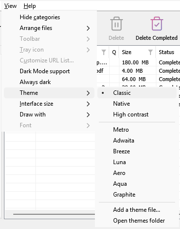

# Getting started

[← Back to docs index](README.md)

MDM runs on 64-bit Windows 10 and Windows 11.

## Choose a download

Every version is on the [Releases](https://github.com/anefzaoui/misterdownloadmanager/releases) page. There are three files:

| File | What it is |
|---|---|
| `MisterDownloadManager-<version>-setup.exe` | The installer. Pick this one unless you have a reason not to. It can set up browser integration and open `.torrent` files and magnet links with MDM. |
| `MisterDownloadManager-<version>-portable.zip` | A portable copy. The download list and settings stay in a `data` folder next to the program, and nothing is written to the registry. Browser integration needs the installer. See [Portable mode](portable.md). |
| `MisterDownloadManager-<version>-x64.zip` | The same programs without an installer. It keeps its data in `%APPDATA%\misterdownloadmanager`, like an installed copy. |

## Install with the setup

1. Run `MisterDownloadManager-<version>-setup.exe`.
2. Choose whether to install for you only or for everyone on the computer. For you only needs no administrator rights and goes to `%LOCALAPPDATA%\Programs\Mister Download Manager`. For everyone goes to `Program Files`.
3. Pick what the setup should do:
   - **Set up browser integration (Chrome, Edge, Brave, Firefox)**
   - **Open .torrent files and magnet links with Mister Download Manager**
   - **Start Mister Download Manager when Windows starts**
   - **Create a desktop shortcut** (off unless you tick it)
4. Click **Install**, then **Finish** to start MDM.

If MDM is already running, the setup asks it to save and close first. To update, use **Help → Check for updates → Update now**, or run the setup of the new version; your list and settings stay.

Browser integration needs one more step in each browser: adding the extension. In Firefox, click **Add to Firefox** on [its page on addons.mozilla.org](https://addons.mozilla.org/firefox/addon/mister-download-manager/); in Chrome, Edge, Brave, Opera and Vivaldi, **Add to Chrome** on [its page in the Chrome Web Store](https://chromewebstore.google.com/detail/mister-download-manager/ejoleppdfgjdndddcjoehopknmlglojp). [Browser integration](browser-integration.md) shows how.

### Uninstall

Uninstall MDM from Windows **Settings → Apps**. The uninstaller asks whether to delete your download list and settings too. Your downloaded files are never touched.

## Use a zip copy

1. Unzip the file to a folder you can write to (not straight into `Program Files`).
2. Run `misterdownloadmanager.exe`.

The zips hold the same programs as the setup: the app, `misterdownloadmanager-cli.exe` (downloads from the command line; see [Command line and automation](command-line.md)) and the `extension` folder.

## The video helpers

Next, MDM offers its two free video helpers: **yt-dlp**, which finds the video on a page, and
**ffmpeg**, which joins its picture and sound. Click **Yes, download them (recommended)** and they
download in the background, about 100 MB, once. **Not now** leaves them for later: the video
window offers them when you first need them. More in [Videos](video.md).

*Yes downloads both helpers in the background, once.*

## The main window

*1 the menu bar, 2 the toolbar, 3 the categories, 4 the download list.*

From top to bottom:

- **Menu bar.**
  - **Tasks** — add downloads, torrents, magnet links, batch downloads and videos from a page; **Torrent settings**; **Link grabber**; **RSS feeds**; show the drop target; import and export the list; exit.
  - **File** — the selected download: **Stop Download**, **Remove**, **Download Now**, **Redownload**.
  - **Downloads** — **Pause All**, **Stop All**, **Delete All Completed**, **Find**, the **Scheduler**, queues, the **Speed Limiter** and **Options**.
  - **View** — show or hide the categories, sort the list (**Arrange files**), **Dark Mode support**, **Always dark**, **Theme**, **Interface size** (every window larger, 100 % to 200 %; **Ctrl +**, **Ctrl −** and **Ctrl 0** too), **Draw with** (OpenGL or Direct3D) and **Language**.
  - **Help** — help pages and tutorials (on the website), **Keyboard shortcuts**, **Report a problem**, **Check for updates**, **About**, **Tell a friend** and **Support MDM** (its creator's GitHub Sponsors page: optional, nothing in MDM changes).
- **Toolbar.** **Add URL**, **Add Torrent**, **Resume**, **Stop**, **Stop All**, **Delete**, **Delete Completed**, **Options**, **Scheduler**, **Start Queue**, **Stop Queue**. The small arrow next to **Add Torrent**, **Start Queue** and **Stop Queue** opens more choices.
- **Categories** (left). Choose what the list shows: **All Downloads**, **Unfinished**, **Finished** and **Queues**, each with its categories. Drag the gap between the pane and the list to make it wider.
- **Download list** (right). One row per download. See [The download list](download-list.md).

## Dark mode

MDM follows your system: when Windows is set to dark mode, so is MDM. To keep MDM light whatever the system does, turn off **View → Dark Mode support**. To keep it dark whatever the system does, for example on a desktop that reports no preference, turn on **View → Always dark**.

*1 Dark Mode support follows the system; 2 Always dark keeps MDM dark.*

## Themes

**View → Theme** changes MDM's look at once, keeping its layout:

- **Classic**: MDM's own look, the default.
- **Native**: your system's colours. Windows' accent colour (Settings → Personalization →
  Colors) and, when it is on, its contrast theme. It follows them when you change them.
- **High contrast**: black and white, a bright accent, every edge drawn, text at 7:1 or more.
- **Metro**: Windows 8's flat look: square corners, flat buttons and boxes, a coloured title bar
  with the title centred (on Windows, where MDM draws it), and one-colour icons (Microsoft's
  Fluent UI System Icons).
- **Adwaita**: GNOME's look: round corners, flat grey buttons, a rounded focus ring, GNOME's
  check boxes, a header bar with the title in bold and round buttons (on Windows, where MDM
  draws it), and GNOME's Adwaita icons, in colour for files and categories, one colour in the
  toolbar.
- **Breeze**: KDE Plasma's look: rounded corners, buttons and boxes that take the accent's edge
  under the pointer or when focused, KDE's check boxes and focus frame, KDE's title bar with the
  title centred and round buttons (on Windows, where MDM draws it), and KDE's Breeze icons.
- **Luna**: Windows XP's look: buttons shaded from white with an orange glow under the pointer,
  green ticks, square text boxes, progress in green blocks, a deep blue title bar with the title
  in bold (on Windows, where MDM draws it), and colourful icons drawn for MDM in that manner.
- **Aero**: Windows 7's look: glossy buttons that turn light blue under the pointer, quiet check
  boxes, a glossy green progress bar, a glassy title bar with the title on a soft glow (on
  Windows), and glossy icons drawn for MDM in that manner.
- **Aqua**: Mac OS X's look: gel buttons round at the ends (the default one blue), glossy check
  boxes, a blue focus ring, a blue gel progress bar, a grey title bar with small round buttons
  (on Windows), and icons drawn for MDM in that manner.
- **Graphite**: MDM's own new look: near-black and white with royal amethyst for what you chose
  (the selection, ticked boxes, the focus ring) and electric cyan for what moves (progress, the
  default button), rounded corners, a focus ring, taller rows in the download list, a flat title
  bar in the panels' colour (on Windows), and thin outline icons in one colour (Tabler's). Its
  typeface comes later.

*View → Theme switches at once, keeping the layout.*

<!-- pictures -->

- 
  *Classic*
- 
  *High contrast*
- 
  *Adwaita*
- 
  *Breeze*

Each has a light and a dark side: **Dark Mode support** and **Always dark** choose between
them as before. Theme files you put in the themes folder (**View → Theme → Open themes folder**)
are listed there too, and so are Base16 and pywal colour schemes (**View → Theme → Add a theme
file…**; **pywal** follows `wal` as it runs): [Themes](themes.md) says where that folder is, what
a theme file holds (`inherits`, colours, sizes, control shapes, icons), how a scheme's colours are
used, and how to make and share one.

## The tray icon

Closing the main window doesn't quit MDM. It hides in the notification area, and downloads, queues and schedules carry on. To make closing quit (a portable copy's folder can then be deleted), untick **Options → General → Keep running when closing the window**. If there is no icon for MDM at all — not in the notification area, nor behind the ^ hidden icons — the window minimizes to the taskbar instead, so downloads continue and there is a way back. An icon behind ^ can be clicked to bring the window back, and starting MDM again always does.

- Click the tray icon to bring the window back.
- Right-click it for **Add new download**, **Add batch download**, **Downloads in progress**, **Speed Limiter**, **Scheduler**, the main download queue, **Options** and **Exit**.
- **Downloads in progress** lists the running downloads. Choose one to see its progress window.

Minimize hides the main window there too, while **Minimize to the notification area** is on in **Options → General**. It is on by default; where the tray has no icon, Minimize sends the window to the taskbar instead.

A download's progress window can go there as well, with its Minimize or with its **Hide to the notification area** button: a short dash with an arrow down to the corner.

That button is in the window's title bar, left of Minimize, and in the title bar's menu (Alt+Space).

To bring the window back, choose it in **Downloads in progress**, or double-click the download in the list.

To quit, choose **Tasks → Exit** or **Exit** in the tray menu.

## Where MDM keeps its data

The download list and settings are in `%APPDATA%\misterdownloadmanager` (`downloads.json`). A portable copy keeps them in its `data` folder instead. Downloaded files go to your **Downloads** folder, sorted into a folder per category; you can change that in **Options → Save to**.

## Next steps

- [Download your first file →](guide-first-download.md)
- [Send browser downloads to MDM →](browser-integration.md)
- [Learn the download list →](download-list.md)
