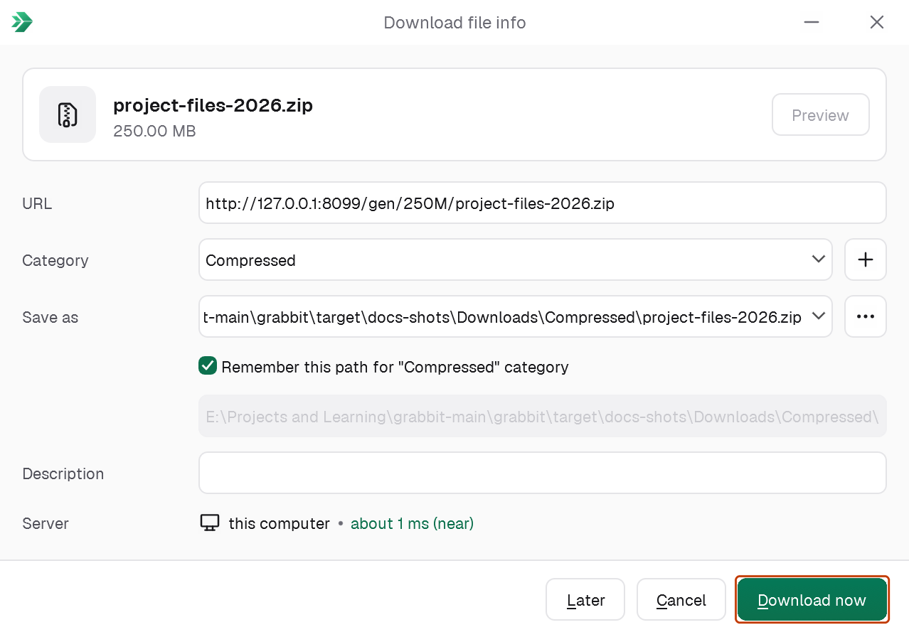
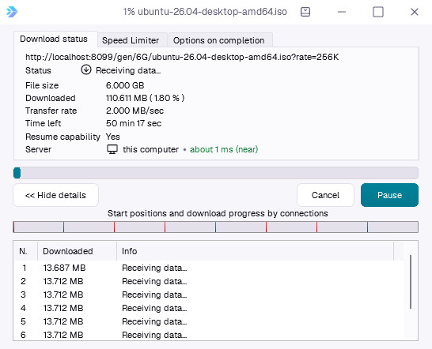
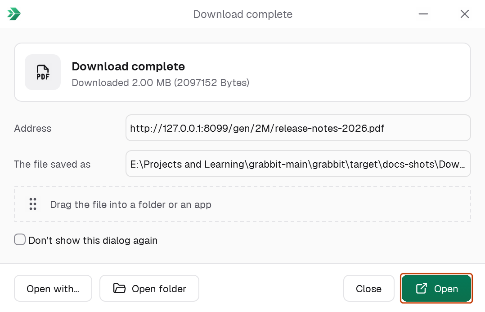
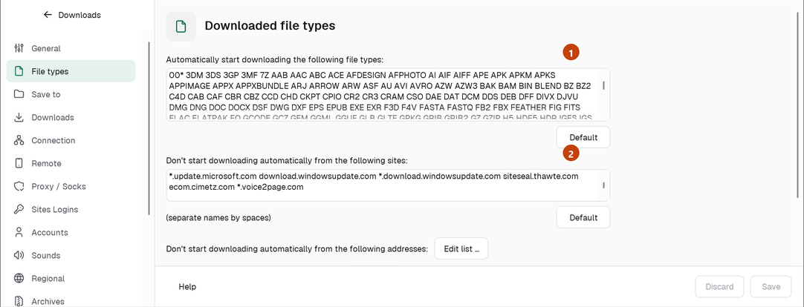

# Tutorial: catch downloads from your browser

[← Back to docs index](README.md)

Set up the extension once, and every download link you click in Firefox, Chrome, Edge, Brave, Opera or Vivaldi goes to Grabbit.

## Before you start

Grabbit must be installed with the setup, with **Set up browser integration (Chrome, Edge, Brave, Firefox)** ticked. It is ticked by default. If you're not sure, run the setup again. A portable copy can't do this.

The extension isn't in the Chrome Web Store or on addons.mozilla.org yet: it comes with Grabbit, in the `extension` folder where Grabbit is installed, and you add it from there once. (An extension named **Mister Download Manager** in the stores belongs to another project: it doesn't connect to Grabbit.) Grabbit's **Add Grabbit to your browser** window, which opens at each start until a browser's extension has reached Grabbit, brings you here: **Show me how** opens the steps for that browser.

Once it is set up, a download link goes like this:

<!-- steps -->

1. 
   *Click a download link in the browser: Download File Info opens in Grabbit.*
2. 
   *Start Download: the progress window shows it coming in.*
3. 
   *Download complete: Open the file, or Open folder.*

## In Chrome, Edge, Brave, Opera or Vivaldi {#chromium}

1. Open your browser's extensions page: type `chrome://extensions`, `edge://extensions`, `brave://extensions`, `opera://extensions` or `vivaldi://extensions` in the address bar.
2. Turn on **Developer mode** (a switch at the top right; in Edge, on the left).
3. Click **Load unpacked**.
4. Choose the `extension\chromium` folder inside Grabbit's folder. If you installed Grabbit for yourself, that is `%LOCALAPPDATA%\Programs\Grabbit\extension\chromium`; if you installed it for everyone, `C:\Program Files\Grabbit\extension\chromium`. You can paste the path into the folder box.
5. **Grabbit** appears in the list. Make sure it is turned on. The browser keeps it from then on, and Grabbit's updates bring its new version: the browser picks it up at its next start.
6. Go to a web page and click a download link, for example a ZIP or an EXE: Grabbit opens **Download File Info** instead of the browser downloading the file. Click **Start Download**.

Chrome may show a reminder about extensions in developer mode at its start: that is this copy, and you can close it.

## In Firefox {#firefox}

Firefox installs for good only add-ons that Mozilla has signed, and Grabbit's isn't signed yet. Until it is:

- **Firefox, for this session:** open `about:debugging#/runtime/this-firefox`, click **Load Temporary Add-on...** and choose `mdm-firefox.xpi` in the `extension` folder inside Grabbit's folder (`%LOCALAPPDATA%\Programs\Grabbit\extension\mdm-firefox.xpi` if you installed Grabbit for yourself). It works until Firefox closes; load it again after a restart.
- **For good, in Firefox Developer Edition or Nightly** (or ESR), which may install an unsigned add-on: open `about:config`, set `xpinstall.signatures.required` to `false`, then open `about:addons`, click the gear button, **Install Add-on From File...**, and choose the same `mdm-firefox.xpi`. Release Firefox ignores that setting.

Then go to a web page and click a download link: Grabbit opens **Download File Info**. Click **Start Download**. Zen and LibreWolf take the add-on the same way.

You don't need to start Grabbit first: if it isn't running, it starts by itself.

## Choose what Grabbit takes

- **Which file types:** **Options → File types → Automatically start downloading the following file types**. Add or remove types, separated by spaces.
- **Sites to leave alone:** **Options → File types → Don't start downloading automatically from the following sites**. Add the site's name, for example `downloads.example.com` or `*.example.com`.
- **One browser only:** **Options → General → Capture downloads from the following browsers**. Untick the ones Grabbit should leave alone.

*1 the file types Grabbit takes, 2 the sites it leaves to the browser.*

Everything Grabbit doesn't take stays with the browser.

## Download a link the browser would open

Links to a PDF or a video file, which the browser would open itself, go to Grabbit too when their type is listed. To leave one to the browser, hold **Alt** while clicking it: the browser opens it as a plain click would. Any other link: right-click it and choose **Download with Grabbit**, which takes any type.

## Next steps

- [Browser integration in detail (Firefox, private windows, what is sent) →](browser-integration.md)
- [If the browser doesn't hand downloads over →](troubleshooting.md#the-browser-doesnt-send-downloads-to-mdm)
- [Download overnight →](guide-download-overnight.md)
