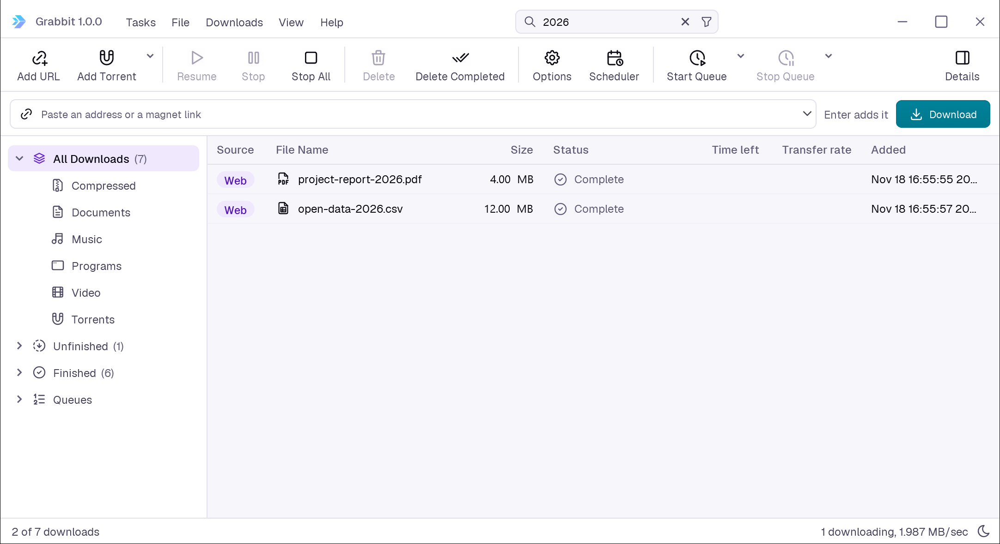

# Tutorial: find a download in a long list

[← Back to docs index](README.md)

After a few months the list can hold hundreds of downloads. Here are four ways to get to the one you want.

## Find by name

1. Click the **Find** field in the title bar, or press **Ctrl+F** (or **Downloads → Find**).
2. Type part of the file's name. The list keeps only the downloads that match as you type, and the status bar says how many of them it shows (**3 of 250 downloads**).
3. Press **Enter** or **F3** to select the next match, **Shift+Enter** or **Shift+F3** the one before. It wraps round.
4. Press **Esc**, or click **×** in the field, to see every download again.

*Ctrl+F, then type part of the name.*

## Find by description or address

Click the funnel at the end of the **Find** field. Under **Match in**, tick where to look:

- **File name** — on by default.
- **Description** — your notes.
- **Site and address** — the address, the site's name and the page the download came from. Tick this to find everything from one site.

**Match case** tells capitals apart. **Match whole word only** skips matches inside a longer word (`setup` finds `my setup.exe`, not `setup2.exe`).

The same menu shows only some downloads by **Status** (Downloading, Stopped, Waiting, Complete, Error) and **Source** (Web, Torrent): click a chip to hide or show those. They are the column filters below, so a filter set on a column title shows here too. A dot on the funnel means something narrows the list; **Clear all** shows everything again. **Esc** closes the menu.

## Filter the list

Each column title has a faint funnel. Click it to keep only some rows:

- On **Status**, tick only **Error** to see the downloads that failed.
- On **Source**, tick only **Torrent**.
- On **Q**, tick **In a queue** or **Not in a queue**.
- On **File Name**, **Description** and the other columns, type a word.

A filtered column's funnel turns blue. Right-click a column title and choose **Clear all filters**, or **Clear all** in the **Find** field's funnel menu, to see everything again.

## Narrow it down with categories and sorting

- Click **Unfinished** or **Finished** in the categories, or a category such as **Video**, to see only those downloads.
- Click a column title to sort: **Added** for the newest, **Size** for the biggest, **File Name** for A to Z. Click again to reverse.
- With the list selected, type the first letters of a name to jump straight to it.

## Next steps

- [The download list in detail →](download-list.md)
- [Keyboard shortcuts →](keyboard-shortcuts.md)
- [Back to the docs index →](README.md)
